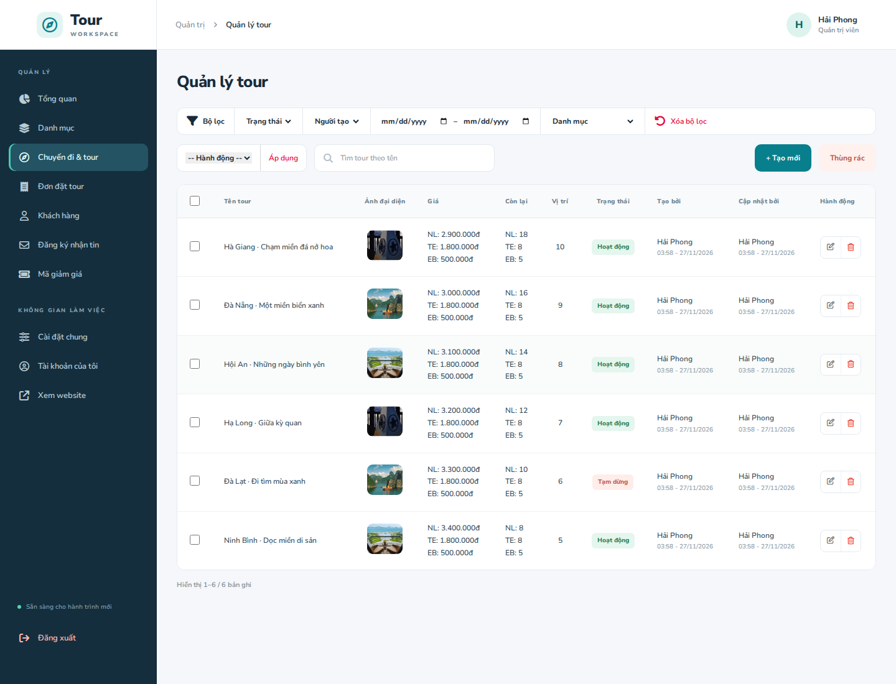
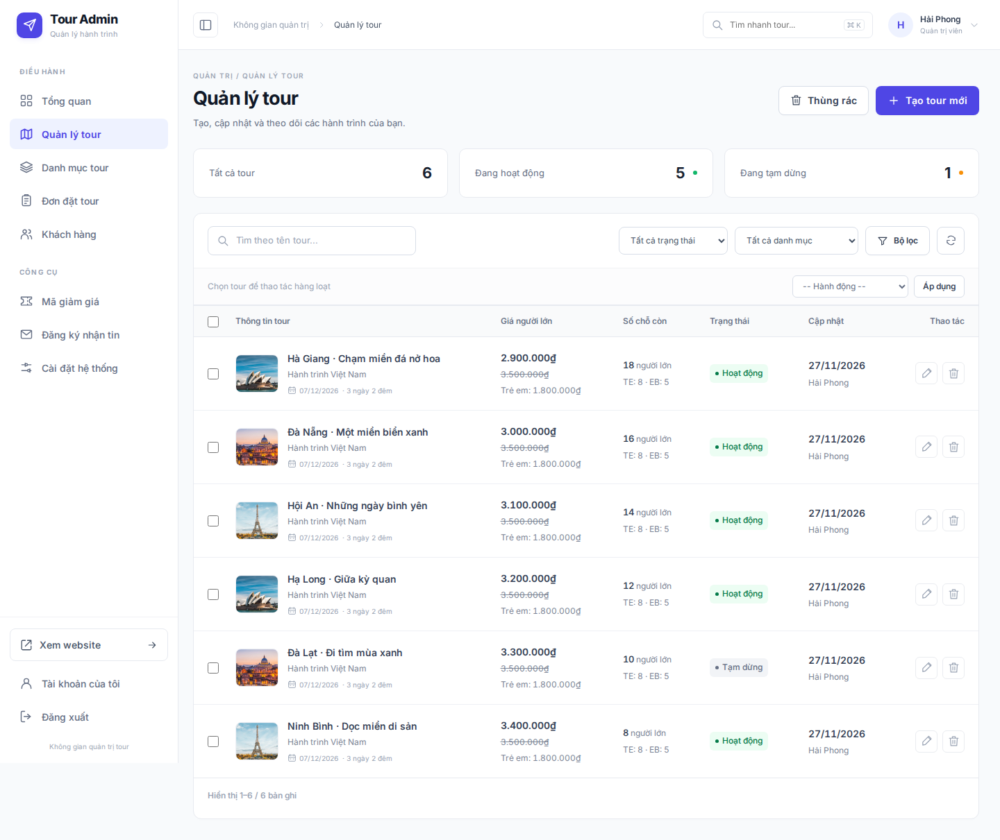
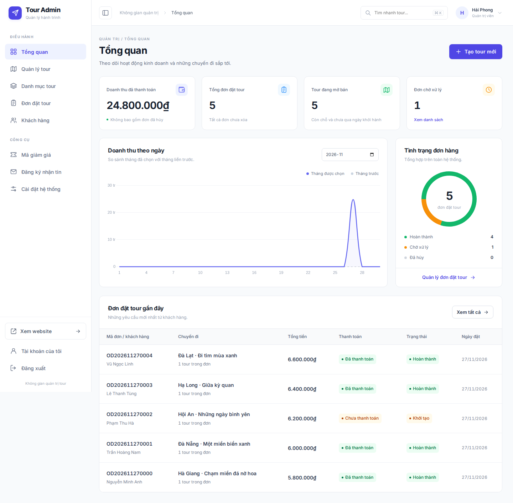

# Báo cáo toàn bộ thay đổi — Tour Du Lịch

Ngày bàn giao: **27/11/2026**. Repository: [nguyenhaiphong0711-bit/Tour_Du_Lich](https://github.com/nguyenhaiphong0711-bit/Tour_Du_Lich). Nhánh cập nhật: **main**.

## 1. Phạm vi và các mốc đối chiếu

| Mốc | Ý nghĩa |
|---|---|
| `676cd2029a7b76b6aa71734ec35541eafbd856ef` | Bản gốc trước toàn bộ các đợt sửa. Các cột “Trước đây” trong danh sách file so với mốc này. |
| `1d87a4b9fcae965a06046a58fc1a3827e52c505e` | Main trước yêu cầu thiết kế lại admin lần này, đã có 31 test tích hợp. |
| `ff4e3c83afaf9addcf0256aaf21805e6790c8d41` | Đợt thay khung admin, biểu mẫu, bảng và sửa lỗi lần đầu của yêu cầu này. |
| `9d78b69622064b4d62e8e333e207ecf5a8e89616` | Hoàn thiện responsive và rà dữ liệu cũ; bộ ảnh UI trong báo cáo lấy từ CI tại mốc này. |
| `efe948b67c3bbf40f0a4e94ca55cbfe7e491d978` | Mã nghiệp vụ hoàn chỉnh sau rà soát: bổ sung cờ đối soát khi xác nhận trả tiền thủ công cho đơn hủy; 45 test tích hợp. |

**Lũy kế so với bản gốc: 129 file, gồm 36 file thêm và 93 file sửa.** Con số bao gồm mã nguồn, cấu hình, lockfile, test, tài liệu và 5 ảnh minh chứng. Đây là số file khác nhau giữa bản gốc và trạng thái bàn giao, không cộng trùng một file qua nhiều commit.

Riêng đợt thiết kế lại và báo cáo này có **61 đường dẫn** thay đổi so với `1d87a4b`: 10 thêm, 50 sửa, 1 xóa. `public/admin/assets/css/workspace.css` là file bị xóa trong đợt này; nó chưa có ở bản gốc `676cd20`, nên không xuất hiện trong danh sách lũy kế 129 file.

[Bảng CSV đầy đủ 129 file](DANH_SACH_FILE_THAY_DOI.csv) có trạng thái theo cả hai mốc. Ký hiệu **A**: thêm, **M**: sửa, **D**: xóa. Danh sách mô tả từng file ở mục 7.

## 2. Giao diện admin được làm lại như thế nào

Đã tham khảo trực tiếp [TailAdmin](https://tailadmin.com/), [shadcn/ui Dashboard](https://ui.shadcn.com/blocks/dashboard) và [Tabler Table](https://docs.tabler.io/ui/components/table). Áp dụng cách bố trí, phân cấp chữ, khoảng cách và hàng công cụ vào Pug/CSS/JavaScript của project; không đưa React hoặc Tailwind vào ứng dụng.

| Thành phần | Trước đợt này | Sau đợt này |
|---|---|---|
| Khung quản trị | Sidebar xanh đậm, điểm nhấn xanh ngọc, CSS gốc cộng file override. | Sidebar trắng, indigo, icon SVG đồng bộ; một stylesheet admin chính. |
| Header | Ngữ cảnh và thao tác còn đơn giản. | Breadcrumb, tìm tour thật, phím Ctrl/Cmd+K, tài khoản/nhóm quyền; thu gọn menu desktop. |
| Dashboard | Banner chào lớn và bố cục thống kê cũ. | 4 thẻ dữ liệu thật, biểu đồ doanh thu theo ngày, tỷ lệ trạng thái đơn và đơn gần đây theo quyền. |
| Danh sách tour | Tên/ảnh rời nhau; nhiều cột chữ viết tắt; bộ lọc dàn dài. | Ghép ảnh/tên/danh mục/lịch đi; giá/chỗ dễ đọc; trạng thái; hàng lọc gọn; bộ lọc mở thêm. |
| Danh mục | Hành động chưa hiển thị theo quyền đầy đủ. | Bảng gọn, nhận diện danh mục gốc/con; chỉ hiện edit/delete/bulk được phép. |
| Đơn hàng | Nhiều dòng thanh toán/tour trong bảng, có nút xóa chưa có xử lý. | Tóm tắt thông tin chính, vào chi tiết để xử lý; bỏ nút xóa không hoạt động. |
| Form tour | Tạo/sửa sao chép hai form dài. | Partial chung 5 nhóm: hành trình, giá/chỗ, ảnh, giới thiệu, lịch trình; panel xuất bản ở bên phải trên desktop. |
| Trang khác | Tiêu đề và khoảng cách thiếu nhất quán. | Mixin page-header, kiểu nút/input/table dùng chung cho hồ sơ, tài khoản, nhóm quyền, cài đặt, coupon, liên hệ và thùng rác. |
| Mobile | Bảng/form/menu khó dùng ở màn nhỏ. | Menu trượt/overlay/Escape, form một cột, ô giá đủ rộng, thẻ doanh thu toàn hàng; bảng cuộn trong khung có hướng dẫn. |
| Trạng thái lỗi | Thiếu thông báo khi tải biểu đồ thất bại hoặc chưa có doanh thu. | Hiện thông báo lỗi/rỗng; chống phản hồi cũ ghi đè tháng vừa chọn. |

Ảnh dùng database kiểm thử riêng, không phải dữ liệu thực tế trên máy hoặc Atlas của chủ repo. Tên danh mục trong ảnh chỉ là dữ liệu minh họa do test tạo.

### Ảnh trước / sau

Trước đợt này:



Sau đợt này:





[Form chỉnh sửa tour đầy đủ](admin-preview/tour-edit.png) · [Dashboard mobile 390px](admin-preview/mobile.png).

## 3. Giữ cấu trúc và phong cách project

Giữ **Express → routes → middleware/validate → controller → Mongoose**, view Pug và JavaScript trình duyệt dùng `fetch`. Không đổi ORM, framework frontend hoặc cấu trúc URL chức năng.

`index.js` vẫn là điểm chạy chính. Nó nạp môi trường, chờ kết nối database/index, mở cổng và chạy tác vụ hoàn chỗ. `app.js` chứa cấu hình Express và export app để test có thể nạp mà không tự mở server hoặc kết nối database thật. Vẫn chỉ chạy `yarn dev`, `yarn start` hoặc `node index.js`; không chạy thêm một server app.js.

Các phần UI dùng lại được thêm đúng thư mục: `views/admin/mixins/icon.pug`, `page-header.pug` và `views/admin/partials/tour-form.pug`. `public/admin/assets/js/script.js` giữ cách chia khối theo chức năng của project. Helper mới dùng CommonJS như mã đang có.

## 4. Các logic nghiệp vụ đã bổ sung hoặc sửa lũy kế

| Nhóm | Quy tắc sau sửa | Tác động |
|---|---|---|
| Danh mục | Admin tự tạo tên và quan hệ cha/con; ngăn vòng lặp; nhánh bị xóa/tạm dừng được ẩn phía khách. | Không có phân loại bắt buộc “tour nước ngoài”. |
| Tour lên trang khách | Tour chưa xóa, hoạt động, nhánh danh mục được phép hiện, chưa qua ngày đi và còn ít nhất một loại chỗ. | Cùng điều kiện cho trang chủ, danh mục, tìm kiếm và chi tiết. |
| Trang chủ | Sinh khối theo danh mục gốc đang hoạt động, lấy cả tour nhiều cấp; tối đa 8 tour/nhóm; danh mục ưu tiên lên trước. | CRUD danh mục/tour thay đổi nội dung trang chủ theo dữ liệu. |
| Tour giờ chót | Tour giảm giá, còn mở bán, khởi hành trong 30 ngày. | Bỏ nội dung ưu đãi minh họa không có dữ liệu. |
| Giá và số chỗ | Số nguyên không âm; giá bán không vượt giá gốc; giá người lớn của tour hoạt động >0; kiểm tra điểm khởi hành. | Chặn dữ liệu sai trước khi lưu. |
| Đặt tour | Lấy giá từ DB, validate khách/số lượng/điểm đi; trừ chỗ và tạo đơn trong transaction. | Hai khách không cùng mua số chỗ cuối; lỗi một item rollback cả đơn. |
| Giữ chỗ | Đơn online mới giữ 30 phút; tác vụ kiểm tra mỗi phút; hủy/hết hạn hoàn chỗ một lần. | Đơn đã thanh toán không tự hết hạn; đơn cũ thiếu expiry không bị hủy hàng loạt. |
| Chuyển trạng thái đơn | Không mở lại đơn hủy trực tiếp; hoàn thành cần đã thanh toán; không đổi phương thức đơn đã tạo. | Tránh làm sai tồn chỗ và lịch sử giao dịch. |
| Thanh toán | Lưu Payment riêng; xác minh chữ ký/MAC, merchant/app, reference và amount; callback lặp không xử lý hai lần. | Return URL không đủ để tin thanh toán nếu chưa xác minh. |
| Đối soát | Thanh toán muộn/trùng hoặc đơn hủy đã thu tiền được gắn paymentReview. | Không tự chiếm lại chỗ đã hoàn; hoàn tiền xử lý riêng tại cổng. |
| Coupon | Mã, hạn, mức tối thiểu, phần trăm và trần giảm được đọc từ server. | Preview và tạo đơn đều tính lại; không tin số tiền frontend. |
| Khách hàng | Tổng hợp đơn theo số điện thoại, tên gần nhất và tổng chi đã thanh toán/chưa hủy. | Thay danh sách khách mẫu, chưa tạo hệ tài khoản khách riêng. |
| ACL | Kiểm tra quyền tại API trước upload/ghi; bulk theo từng hành động; UI phản ánh quyền. | Thiếu nhóm quyền không tự được mở quyền quản trị. |
| Phiên đăng nhập | JWT có purpose/tokenVersion; khóa/xóa/đổi mật khẩu thu hồi phiên cũ. | Tài khoản cũ vẫn dùng mật khẩu đã lưu nếu thông tin/role hợp lệ. |
| OTP/reset | Crypto, hash OTP, hạn 5 phút, số lần thử, tiêu thụ một lần; reset token riêng 10 phút. | Reset token không dùng để đăng nhập; yêu cầu đồng thời chỉ một lần đổi thành công. |
| Cấu hình thật | Ngân hàng/logo/footer từ admin; cổng thanh toán thiếu cấu hình được ẩn. | Bỏ tài khoản ngân hàng demo và lựa chọn MoMo chưa tích hợp. |

### CRUD admin phản ánh ra trang khách

| Thao tác admin | Kết quả phía khách |
|---|---|
| Tạo danh mục gốc hoạt động | Có nhóm/menu tương ứng; tên do admin đặt. Danh mục chưa có tour có thể không có thẻ tour để hiển thị. |
| Tạo danh mục con và tour trong con/cháu | Tour được gom vào nhóm gốc và trang danh mục liên quan theo cây. |
| Sửa tên/giá/ảnh/nội dung tour | Request trang khách tiếp theo đọc dữ liệu đã lưu; ảnh cũ giữ nếu không thay. |
| Tạm dừng/xóa tour | Tour bị ẩn khỏi các danh sách mở bán và trang chi tiết. |
| Tạm dừng/xóa một danh mục cha | Cả nhánh bị ẩn phía khách; dữ liệu tour vẫn còn trong admin. |
| Khôi phục tour từ thùng rác | Tour chỉ hiện trở lại khi đồng thời thỏa trạng thái/danh mục/ngày/chỗ. |
| Khách đặt chỗ/hủy đơn | Số chỗ giảm/hoàn trong transaction và các trang mở bán đọc giá trị mới. |

Danh sách admin giữ các tour tạm dừng/quá ngày để quản trị. Thẻ “Đang hoạt động” ở danh sách đếm theo `status`; “Tour đang mở bán” trên dashboard áp dụng thêm điều kiện hiển thị cho khách.

## 5. Lỗi phát hiện và xử lý trong đợt này

| Vấn đề | Cách sửa | Bằng chứng |
|---|---|---|
| Lưu form lần hai dễ báo xung đột do vẫn gửi updatedAt cũ. | API trả version mới, JS cập nhật hidden field sau thành công. | Test API và browser lưu hai lần. |
| Ảnh đã có bị gửi lại như file mới; xóa/sắp gallery chưa tách khỏi upload. | Metadata URL cũ; chỉ upload file mới; imageOrder kiểm tra URL thuộc chính tour, thứ tự và tối đa 10 ảnh. | Test giữ/xóa ảnh, URL lạ, quá số lượng; browser giữ và bỏ ảnh. |
| Bỏ avatar/logo trong UI nhưng backend vẫn giữ ảnh. | Cờ clearAvatar/clearLogo/clearFavicon riêng; không gửi file vẫn giữ ảnh cũ. | Test danh mục, hồ sơ, logo và favicon không đổi. |
| Form id/name dễ đụng thuộc tính native của form. | Đọc qua `elements.namedItem`. | Browser lưu tour và test API các form. |
| Nút xóa đơn không có nghiệp vụ/API. | Bỏ nút; hủy đơn ở chi tiết để hoàn chỗ đúng một lần. | Kiểm tra template và test hủy đơn. |
| Người chỉ xem vẫn thấy nút ghi/xóa hoặc bulk không được phép. | Ẩn theo quyền, form đơn readonly; server vẫn chặn độc lập. | Test giao diện render theo quyền và API 403. |
| Dashboard-view có thể thấy chi tiết khách dù thiếu order-view. | Không truy vấn/trả danh sách đơn khi thiếu quyền; template hiển thị hướng dẫn. | Test tên/số điện thoại không xuất hiện. |
| Biểu đồ dùng ngày tạo đơn thay vì ngày thu tiền. | Dùng paidAt; xác nhận thủ công lưu paidAt; đơn cũ chưa có dùng createdAt. | Test đơn tạo tháng khác, trả tiền tháng hiện tại. |
| SMTP gửi thất bại vẫn giữ mã OTP và chặn gửi tiếp 5 phút. | Xóa record OTP vừa tạo khi sendMail thất bại; trả lỗi gửi mail. | Test lỗi giả lập rồi gửi lại thành công. |
| Reset token có thể được dùng đồng thời trước khi version tăng. | Update mật khẩu có điều kiện tokenVersion/status/deleted. | Hai request đồng thời: một 200, một 401. |
| Đơn cũ dùng địa điểm dạng chữ khiến CastError khi mở. | Chỉ lookup ObjectId hợp lệ khi chưa có cityName. | Test mở đơn legacy thành công. |
| HTML lưu trước bản sanitize vẫn có thể chạy ở trang khách. | Lọc cả lúc render thông tin tour/lịch trình/mô tả danh mục cũ. | Test HTML cũ không còn script/onerror. |
| Cart JSON hỏng/sai kiểu làm dừng script khách. | readCart/saveCart kiểm tra cấu trúc, bỏ item sai, phục hồi dữ liệu. | Browser thử 3 dạng cart hỏng, không ghi nhận pageerror. |
| Trang khách hàng vượt tổng trang trả bảng rỗng hoặc skip quá lớn. | Đếm tổng rồi clamp page trong phạm vi hợp lệ. | Test page cực lớn vẫn về trang cuối. |
| Một số thao tác xóa/khôi phục báo thành công khi ID không tồn tại. | Kiểm tra matchedCount/deletedCount cho thao tác đơn lẻ liên quan. | Test 404 cho tour/danh mục/contact/tài khoản/role. |
| Role ID dữ liệu cũ sai định dạng làm mất phiên khi mở hồ sơ. | Xem như chưa gán quyền hợp lệ, vẫn cho vào hồ sơ. | Test role dạng chữ cũ render 200. |
| Đơn hủy được xác nhận thu tiền thủ công thiếu cờ đối soát. | Khi trạng thái cuối là cancel + paid luôn gắn paymentReview. | Test xác nhận, hoàn chỗ một lần và paidAt. |

Không có thao tác sửa/xóa dữ liệu sản xuất hoặc tự cấp quyền cho tài khoản thực trong đợt kiểm tra này.

## 6. Kết quả quét và kiểm chứng

| Kiểm tra | Kết quả |
|---|---|
| `npm run check` | 81 file JavaScript kiểm tra cú pháp và 59 template Pug biên dịch đạt. |
| `npm test` | **45/45 đạt**, 0 fail; MongoDB replica set tạm, không đọc `.env`. Bản trước đợt này có 31 test, bổ sung 14 test. |
| `npm run test:browser` | Đạt trên GitHub Actions/Chromium; đăng nhập, search, menu desktop/mobile/Escape, lưu 2 lần, giữ/xóa gallery, phục hồi cart hỏng. |
| Lỗi JavaScript trên các trang browser đã kiểm tra | `browserErrors: []`. |
| Responsive 390px | Dashboard, danh sách tour và form: document width đều 390px; bảng cuộn trong khung. |
| Kết quả tìm kiếm | Từ khóa minh họa trả đúng 1 hàng. |
| `npm audit` và `npm audit --omit=dev` | 0 lỗ hổng do npm báo tại ngày 27/11/2026; không đồng nghĩa ứng dụng không thể còn lỗi. |
| `git diff --check` | Không có lỗi whitespace của bản bàn giao. |
| Xem lại UI | Đã đọc ảnh desktop dashboard/tour/form/danh mục/đơn/cài đặt và mobile; chỉnh tiếp phần tiền/bảng/form sau vòng ảnh đầu. |

**CI mã cuối:** [run 45942681284 — đạt](https://github.com/nguyenhaiphong0711-bit/Tour_Du_Lich/actions/runs/45942681284). **Bộ ảnh UI và test trình duyệt:** [run 45942084857](https://github.com/nguyenhaiphong0711-bit/Tour_Du_Lich/actions/runs/45942084857). Run UI xuất 10 ảnh; 4 ảnh mới và 1 ảnh cũ được lưu lâu dài trong `docs/admin-preview/`.

Phạm vi rà soát gồm mã tracked của repository, route/middleware/validate/controller/helper/model, các form Pug/JS và dependency lockfile. Đây không phải kết quả quét database Atlas thật hoặc kiểm thử tải thực tế. Không khẳng định mọi nhánh dữ liệu hay mọi thiết bị đều đã được bao phủ.

### Những điểm còn cần cấu hình hoặc kiểm chứng khi chạy thật

| Hạng mục | Trạng thái / việc cần làm |
|---|---|
| Dependency local | Cài lại `yarn install --frozen-lockfile` hoặc `npm ci` sau khi pull; tránh lỗi thiếu express-rate-limit dù mã đã có. Dùng Node >=22. |
| Database | Dùng Atlas/replica set cho transaction. Chạy `npm run data:check` để rà email/mã đơn trùng hoặc thiếu trước unique index. Bộ test không tự sửa dữ liệu cũ. |
| Tài khoản quản trị | Nhóm cũ cần được cấp đúng quyền mới. Nếu cần, chủ repo chạy `npm run permissions -- email-quan-tri@example.com` cho tài khoản đã chỉ định; không gán quyền mặc định cho tất cả. |
| JWT và origin | JWT_SECRET tối thiểu 32 ký tự. Đã giữ bản sửa origin: localhost không bị WEBSITE_DOMAIN ngrok cũ chặn, origin ngoài vẫn bị từ chối. |
| Dịch vụ ngoài | Gmail SMTP, Cloudinary, VNPay/ZaloPay cần kiểm tra bằng cấu hình tài khoản/merchant thực hoặc sandbox của chủ repo. Test callback dùng khóa giả lập hợp lệ, không chứng minh tài khoản dịch vụ thật đã chạy. |
| Ngày thanh toán đơn cũ | Chưa có paidAt thì tạm dùng createdAt. Chỉ bổ sung paidAt khi có chứng cứ thời gian thu tiền, không tự backfill bằng phỏng đoán. |
| Link thanh toán cũ | Link không có record Payment mới cần đối soát; không tự nhận paid cho giao dịch cũ thiếu reference. |
| Hoàn tiền | Cờ “Cần đối soát” và lịch sử giao dịch đã có; chưa tự gọi API hoàn tiền. Xử lý tại cổng thanh toán rồi đối soát nghiệp vụ. |
| Tệp ảnh Cloudinary | Xóa ảnh trong form bỏ tham chiếu trong bản ghi. Chưa có tác vụ thu gom tự động các asset cũ dùng chung trên Cloudinary. |
| Tài nguyên frontend | Các CDN/TinyMCE/FilePond/Chart.js đang theo cấu trúc project. Browser CI đã tải và chạy được; website thực vẫn cần mạng/truy cập CDN hợp lệ. |

Trong các lỗi đã tái hiện và các luồng kiểm thử nêu trên, không còn test thất bại. Các mục dịch vụ/dữ liệu thật ở bảng trên cần kiểm chứng trong môi trường triển khai; không được coi là đã xác minh chỉ từ test tạm.

## 7. Danh sách từng file: thêm gì, sửa gì, khác bản gốc ra sao

Các mô tả dưới đây là **lũy kế so với `676cd20`**. Những file không đổi trong đợt giao diện này vẫn xuất hiện nếu đã được sửa ở đợt trước. Cột “Đợt giao diện” trong CSV cho biết khác biệt riêng với `1d87a4b`.

### 7.1. Entry point, cấu hình và dependency

| Loại / file | Trước đây | Sau sửa | Nghiệp vụ / tác động |
|---|---|---|---|
| **M** `.env.example` | Thiếu hướng dẫn đầy đủ cho cấu hình mới. | Bổ sung PORT, TRUST_PROXY, JWT đủ dài, tên miền, cổng thanh toán và biến dịch vụ. | Cấu hình triển khai, không chứa khóa thật. |
| **A** `.github/workflows/check.yml` | Chưa có quy trình kiểm tra tự động này. | CI dùng Node 24, image Playwright cố định; cài dependency, kiểm tra cú pháp, integration, browser và xuất ảnh. | Phát hiện lỗi khi đẩy main/PR. |
| **M** `.gitignore` | Chỉ loại node_modules. | Loại .env, database/thư mục test tạm và ảnh chụp sinh tự động. | Tránh đưa dữ liệu cấu hình và đầu ra tạm vào git. |
| **A** `README.md` | Chưa có hướng dẫn cập nhật/kiểm tra này. | Hướng dẫn chạy, dependency, database replica set, quyền, thanh toán, kiểm thử và liên kết báo cáo. | Quy trình vận hành. |
| **A** `app.js` | Toàn bộ cấu hình Express gắn trong index.js. | Tách app Express có thể require; đăng ký middleware, static, view, route, origin, health và xử lý lỗi. | Cho phép kiểm thử ứng dụng mà không tự mở server thật. |
| **M** `config/database.config.js` | Kết nối database không được chờ ở luồng khởi động. | connect trả Promise, kiểm tra DATABASE và truyền lỗi lên startup. | Server khởi động sau khi kết nối thành công. |
| **M** `config/variable.config.js` | Danh sách quyền chưa bao phủ các trang quản trị; có MoMo mẫu. | Bổ sung quyền chức năng; giữ trạng thái/phương thức thật và bỏ MoMo khỏi lựa chọn đang hỗ trợ. | ACL và các tùy chọn thanh toán. |
| **M** `index.js` | Vừa cấu hình Express vừa mở cổng trong cùng file. | Giữ entry point; tải env/TZ, kiểm tra JWT, chờ DB/index; mở app, timer hoàn chỗ, shutdown. | Một tiến trình; vẫn chạy node index.js/yarn dev. |
| **A** `package-lock.json` | Chưa có lockfile npm tương ứng. | Thêm lockfile đồng bộ package.json. | npm ci cài đúng dependency đã kiểm tra. |
| **M** `package.json` | Thiếu dependency/commands kiểm tra; có adapter Cloudinary xung đột. | Thêm qs, rate-limit, sanitize-html và công cụ test; sửa scripts, Node >=22; bỏ adapter xung đột. | Cần cài dependency sau khi cập nhật. |
| **M** `yarn.lock` | Dependency cũ có adapter Cloudinary xung đột và thiếu gói mới. | Đồng bộ phiên bản với package.json và dependency đã vá. | yarn install --frozen-lockfile cài đủ gói. |

### 7.2. Controllers

| Loại / file | Trước đây | Sau sửa | Nghiệp vụ / tác động |
|---|---|---|---|
| **M** `controllers/admin/account.controller.js` | Đăng nhập/OTP/reset còn thiếu thu hồi phiên, giới hạn mục đích và xử lý lỗi gửi mail. | JWT có tokenVersion/purpose; OTP hash, hết hạn, số lần thử, tiêu thụ một lần; SMTP lỗi xóa mã; reset ghi có điều kiện. | Đổi mật khẩu chỉ thành công một lần kể cả yêu cầu đồng thời. |
| **M** `controllers/admin/category.controller.js` | Lọc/phân trang và xử lý danh mục còn rời rạc; có vòng lặp cha/con; kết quả cập nhật thiếu kiểm tra. | Lọc dữ liệu hợp lệ, gom tên tác giả; kiểm tra cha/con, quyền bulk; cờ xóa ảnh; báo lỗi nếu không còn bản ghi. | CRUD danh mục tự đặt tên, không chia cứng trong/nước ngoài. |
| **M** `controllers/admin/contact.controller.js` | Danh sách nhận tin và nút xóa thiếu luồng đầy đủ. | Tìm email, phân trang thật, thời gian; xóa mềm có kiểm tra matchedCount. | Quản lý đăng ký nhận tin thật. |
| **A** `controllers/admin/coupon.controller.js` | Chưa có quản lý coupon thật. | Thêm danh sách, tạo/sửa, kiểm tra thông tin và đổi trạng thái mã. | Quản lý mã giảm giá. |
| **M** `controllers/admin/dashboard.controller.js` | Thống kê lấy nhiều bản ghi, dữ liệu đơn gần đây chưa được bảo vệ theo quyền; doanh thu theo ngày tạo. | Aggregate tổng quan; đếm tour còn mở; chỉ trả chi tiết đơn khi có order-view; doanh thu dùng paidAt, fallback đơn cũ. | Số liệu thật và phân quyền dữ liệu khách. |
| **M** `controllers/admin/order.controller.js` | Cập nhật đơn chưa bảo vệ toàn bộ trạng thái/thanh toán và hoàn chỗ. | Transaction khi hủy; không mở lại đơn hủy/đổi cổng; không tự sửa thanh toán online; lưu paidAt xác nhận thủ công; đọc địa điểm cũ an toàn. | Quy tắc chuyển trạng thái đơn và đối soát. |
| **M** `controllers/admin/profile.controller.js` | Có thể nhận quá nhiều trường từ hồ sơ; chưa thu hồi JWT khi đổi mật khẩu. | Allowlist fullName/email/phone, hash mật khẩu, tăng tokenVersion; cờ xóa avatar riêng. | Không cho tự gán quyền qua hồ sơ. |
| **M** `controllers/admin/setting.controller.js` | Cấu hình/tài khoản/nhóm quyền chưa đủ kiểm tra và tìm kiếm; thiếu một số API xóa. | Allowlist và validate; bảo vệ tài khoản/nhóm đang dùng; thu hồi phiên; CRUD xóa thật; lưu ngân hàng; giữ/xóa logo, avatar rõ ràng. | Quản trị cấu hình, tài khoản và quyền. |
| **M** `controllers/admin/tour.controller.js` | Lọc dữ liệu, upload gallery và cập nhật tồn chỗ có thể sai; lưu biểu mẫu lặp thiếu phiên bản mới. | Bộ lọc và phân trang thật; summary; map danh mục; action theo quyền; optimistic updatedAt; giữ/sắp/xóa ảnh qua imageOrder; trả phiên bản mới; kiểm tra tồn tại khi xóa. | CRUD tour phản ánh trang khách và tránh ghi đè chỗ vừa bán. |
| **M** `controllers/admin/user.controller.js` | Trang khách hàng dùng dữ liệu minh họa. | Tổng hợp khách theo số điện thoại từ đơn, tổng chi đã trả/chưa hủy; tìm kiếm và giới hạn trang hợp lệ. | Không tạo hệ tài khoản khách riêng. |
| **M** `controllers/client/cart.controller.js` | Dữ liệu giỏ hàng chưa kiểm tra đầy đủ, coupon chỉ là giao diện mẫu. | Đọc tour/giá/chỗ/địa điểm từ server, kiểm tra cấu trúc; thêm API xem trước giảm giá. | Giá coupon và giỏ hàng được kiểm tra lại phía server. |
| **M** `controllers/client/category.controller.js` | Hiển thị nhánh con chưa đầy đủ; có thể hiện nhánh bị ẩn. | Kiểm tra toàn nhánh, lấy tour con nhiều cấp, lọc điều kiện mở bán; lọc HTML cũ khi render. | CRUD danh mục ảnh hưởng đúng danh sách phía khách. |
| **M** `controllers/client/contact.controller.js` | Email request được dùng trực tiếp trước kiểm tra đăng ký cũ. | Validate, trim và lowercase email trước khi kiểm tra đăng ký đã có. | Đăng ký nhận tin, không phải gửi newsletter tự động. |
| **M** `controllers/client/home.controller.js` | Các khối tour/danh mục và nội dung mẫu viết cố định. | Sinh các khối theo danh mục admin; tối đa 8 tour/nhóm; ưu tiên cấu hình; giờ chót theo giảm giá và ngày đi. | Không có quy tắc bắt buộc danh mục tour nước ngoài. |
| **M** `controllers/client/order.controller.js` | Tạo đơn/thanh toán tin nhiều dữ liệu từ trình duyệt và thiếu theo dõi giao dịch. | Gọi booking helper, tạo reference Payment, kiểm tra callback VNPay/ZaloPay; thêm IPN và trang lỗi; xử lý timeout. | Đặt chỗ và xác nhận thanh toán có kiểm tra chữ ký/số tiền. |
| **M** `controllers/client/search.controller.js` | Tìm kiếm có thể trả tour không còn mở và xử lý điều kiện chưa đồng nhất. | Dùng visibleFilter và validate điều kiện tìm kiếm; định dạng tour nhất quán. | Tìm kiếm tuân thủ trạng thái danh mục/tour. |
| **M** `controllers/client/tour.controller.js` | Chi tiết tour có thể hiện tour ẩn hoặc HTML cũ chưa lọc. | Dùng visibleFilter; breadcrumb đủ cấp; lọc information/schedules khi render. | Chặn tour không mở và HTML nguy hiểm từ dữ liệu cũ. |

### 7.3. Helpers, middleware và validate

| Loại / file | Trước đây | Sau sửa | Nghiệp vụ / tác động |
|---|---|---|---|
| **A** `helpers/booking.helper.js` | Logic đặt chỗ nằm lẫn trong controller và thiếu transaction đầy đủ. | Tạo đơn bằng transaction, giá server, trừ chỗ có điều kiện; giải phóng đúng một lần; hết hạn 30 phút cho online. | Nghiệp vụ giữ chỗ, rollback, hủy/hết hạn. |
| **M** `helpers/category.helper.js` | Đệ quy cha/con bị mất kết quả và có nguy cơ vòng lặp. | buildCategoryTree, getCategoryChild/Parent, validateParent, visibleIds có visited. | Cây danh mục tự do và ẩn cả nhánh. |
| **M** `helpers/cloudinary.helper.js` | Dùng multer-storage-cloudinary xung đột Cloudinary 2. | Storage dùng upload_stream; giới hạn 5 MB/ảnh và MIME hỗ trợ; xử lý xóa tệp khi Multer yêu cầu. | Upload ảnh tương thích dependency. |
| **A** `helpers/coupon.helper.js` | Chưa có tính giảm giá thật. | Tra mã đang hoạt động, kiểm tra hạn/mức tối thiểu, tính phần trăm và mức trần. | Tính discount bằng dữ liệu server. |
| **A** `helpers/data.helper.js` | Chưa có helper tập trung cho allowlist/sanitize/phân trang. | Thêm pick, cleanHtml, escapeRegex và pagination giới hạn trang. | Kiểm tra dữ liệu dùng chung. |
| **M** `helpers/generate.helper.js` | Mã ngẫu nhiên dựa Math.random. | Sinh số ngẫu nhiên bằng crypto. | OTP và mã đơn khó đoán hơn; unique index vẫn kiểm tra trùng. |
| **M** `helpers/mail.helper.js` | Gửi mail chưa trả Promise để controller xử lý kết quả. | Trả kết quả transporter.sendMail. | Controller biết gửi mail thành công/thất bại. |
| **A** `helpers/payment.helper.js` | Chưa có xử lý giao dịch tập trung, chống lặp/đến muộn đầy đủ. | HMAC/sort VNPay, timingSafeEqual, settle trong transaction; cờ đối soát nếu muộn/trùng. | Thanh toán an toàn hơn, không tự giữ lại chỗ đã hoàn. |
| **A** `helpers/tour.helper.js` | Các trang khách tự định nghĩa điều kiện tour khác nhau. | visibleFilter dùng chung, decorate giá giảm/ngày đi an toàn. | Ẩn tour hết chỗ, quá ngày hoặc nhánh danh mục ẩn. |
| **M** `middlewares/admin/auth.middleware.js` | Phiên/role thiếu kiểm tra đủ; thiếu nhóm dễ mất trang quản lý hoặc lỗi render. | Kiểm tra tài khoản active, tokenVersion/purpose, reset token; khởi tạo permissions=[]; nhóm cũ sai ID vẫn vào hồ sơ. | ACL server, thu hồi phiên, không tự mở quyền khi thiếu nhóm. |
| **A** `middlewares/admin/rate-limit.middleware.js` | Chưa có giới hạn cho các endpoint này. | Giới hạn đăng nhập, OTP và tạo đơn theo cửa sổ thời gian. | Hạn chế thử mật khẩu/OTP và gửi đơn liên tục. |
| **M** `middlewares/client/category.middleware.js` | Menu danh mục chưa dùng cây đa cấp nhất quán. | Nạp và dựng cây theo vị trí/trạng thái cho header. | Menu sinh từ danh mục admin. |
| **M** `middlewares/client/setting.middleware.js` | Không có bản ghi cấu hình có thể gây lỗi; phương thức thanh toán mẫu vẫn hiện. | Giá trị mặc định, paymentAvailable theo biến cấu hình. | Ẩn cổng thanh toán chưa cấu hình, trang khách vẫn render được. |
| **M** `validates/admin/account.validate.js` | Validate nhưng chưa dùng nhất quán kết quả chuẩn hóa. | Gán value Joi trả về, chuẩn hóa email; validate các bước tài khoản. | Dữ liệu đăng nhập/OTP/reset nhất quán. |
| **M** `validates/admin/category.validate.js` | Thiếu kiểm tra vòng lặp/HTML/trường dữ liệu. | Joi, validateParent, cleanHtml, cờ clearAvatar. | Danh mục hợp lệ và nội dung an toàn. |
| **M** `validates/admin/tour.validate.js` | Thiếu ràng buộc toàn bộ giá/chỗ/điểm đi/gallery. | Validate số nguyên, danh mục tồn tại, city hợp lệ, schedules; sanitize; imageOrder tối đa 10; chuẩn hóa số trước parseInt. | Ngăn giá âm, giảm vượt giá gốc, điểm đi không tồn tại. |
| **A** `validates/client/order.validate.js` | Chưa có schema đặt tour tách riêng. | Joi cho khách, phone, phương thức, item và tổng số lượng >0; không nhận giá/tổng tự khai. | Chặn payload đặt tour sai. |

### 7.4. Models

| Loại / file | Trước đây | Sau sửa | Nghiệp vụ / tác động |
|---|---|---|---|
| **M** `models/account-admin.model.js` | Email và trạng thái chưa ràng buộc đủ, thiếu version phiên. | Unique email chuẩn hóa, enum status, tokenVersion. | Dữ liệu tài khoản và thu hồi JWT. |
| **A** `models/coupon.model.js` | Chưa có collection mã giảm giá. | Thêm code unique, percent, minTotal/maxDiscount, expiresAt/status. | Dữ liệu coupon thật. |
| **M** `models/forgot-password.model.js` | OTP chưa có đầy đủ số lần thử/hash/thời hạn rõ ràng. | Lưu hash OTP, attempts, expireAt và TTL. | TTL dọn dữ liệu; API vẫn kiểm tra hạn trực tiếp. |
| **M** `models/order.model.js` | Đơn thiếu ràng buộc số lượng, thời hạn giữ chỗ và thông tin đối soát. | Snapshot item, giá/chỗ không âm, code unique; expiry/stockReleased/paymentReview/paidAt; index truy vấn. | Giữ chỗ, lịch sử đơn và thanh toán. |
| **A** `models/payment.model.js` | Chưa lưu giao dịch thanh toán riêng. | Reference unique, provider/orderId/amount/status/paidAt/providerTransaction. | Theo dõi từng lần thanh toán và chống xử lý lặp. |
| **M** `models/setting-website-info.model.js` | Chưa có đầy đủ thông tin ngân hàng. | Bổ sung bankName, bankAccountName, bankAccountNumber. | Chuyển khoản dùng cấu hình của website. |
| **M** `models/tour.model.js` | Giá/tồn chỗ thiếu ràng buộc và index hỗ trợ. | Ràng buộc số nguyên không âm/default cho giá và số chỗ đang có; enum trạng thái, tên bắt buộc, index mở bán/danh mục. | Dữ liệu tour thống nhất với đặt chỗ. |

### 7.5. Routes

| Loại / file | Trước đây | Sau sửa | Nghiệp vụ / tác động |
|---|---|---|---|
| **M** `routes/admin/account.route.js` | Đăng nhập/OTP chưa giới hạn và reset chưa tách quyền. | Gắn rate limit, verifyResetToken cho reset; giữ các URL tài khoản. | Bảo vệ xác thực. |
| **M** `routes/admin/category.route.js` | API danh mục chưa chặn quyền đầy đủ trước upload. | Gắn checkPermission theo xem/tạo/sửa/xóa; bulk kiểm tra từng hành động trong controller. | ACL danh mục. |
| **M** `routes/admin/contact.route.js` | Danh sách nhận tin chưa có đủ API thao tác/quyền. | Gắn contact-view/delete và endpoint xóa mềm. | ACL nhận tin. |
| **A** `routes/admin/coupon.route.js` | Chưa có route coupon. | Thêm route danh sách/save/toggle có coupon-manage. | Quản lý mã giảm giá. |
| **M** `routes/admin/dashboard.route.js` | Endpoint thống kê chưa được gắn quyền tương ứng đầy đủ. | Chặn cả trang tổng quan và API revenue-chart bằng dashboard-view. | ACL thống kê. |
| **M** `routes/admin/index.route.js` | Điểm vào admin/chức năng chưa thống nhất theo quyền. | Giữ verifyToken, đăng ký coupon, chọn trang đầu có quyền hoặc hồ sơ. | Không mất trang do chuyển cứng dashboard khi thiếu quyền. |
| **M** `routes/admin/order.route.js` | Trang/API đơn thiếu quyền rõ theo hành động. | GET dùng order-view, PATCH dùng order-edit. | Tách xem và xử lý đơn. |
| **M** `routes/admin/profile.route.js` | Route hồ sơ dùng upload chưa thống nhất giới hạn mới. | Dùng cấu hình upload chung; giữ route edit/change-password. | Hồ sơ trong phạm vi tài khoản hiện tại. |
| **M** `routes/admin/setting.route.js` | Cài đặt/tài khoản/role chưa chặn setting-manage và thiếu API xóa. | Bảo vệ toàn router, dùng storage mới, thêm xóa tài khoản/nhóm quyền. | ACL cấu hình. |
| **M** `routes/admin/tour.route.js` | Quyền route và cấu hình upload chưa đầy đủ. | Chặn xem/tạo/sửa/xóa/trash trước upload, upload ảnh tối đa theo field; bulk kiểm tra action. | ACL tour. |
| **M** `routes/admin/upload.route.js` | Upload editor chưa dùng điều kiện quyền/giới hạn chung. | Yêu cầu quyền chỉnh nội dung tương ứng, dùng cloudinary options và trả JSON lỗi. | Upload từ rich text editor. |
| **M** `routes/admin/user.route.js` | Trang khách hàng chưa dùng quyền riêng. | Gắn user-view trước controller. | ACL khách hàng. |
| **M** `routes/client/cart.route.js` | Chưa có endpoint coupon preview thật. | Thêm POST coupon, giữ cart/detail. | Giá giảm xem trước từ server. |
| **M** `routes/client/contact.route.js` | Endpoint nhận tin chưa có giới hạn tần suất. | Bổ sung rate limit với route nhận email. | Hạn chế gửi đăng ký liên tục. |
| **M** `routes/client/order.route.js` | Luồng thanh toán chưa có IPN/giới hạn đầy đủ. | Gắn giới hạn tạo đơn, khai báo VNPay IPN và callback/return hiện có. | Cổng thanh toán cập nhật qua request được xác minh. |

### 7.6. CSS, JavaScript và tài nguyên công khai

| Loại / file | Trước đây | Sau sửa | Nghiệp vụ / tác động |
|---|---|---|---|
| **M** `public/admin/assets/css/style.css` | CSS giao diện cũ; bản sửa trước còn dựa lớp override riêng. | Thay stylesheet chính bằng sidebar trắng, indigo, panel/table/form, responsive, focus, auth; bỏ lớp override. | Thay đổi giao diện, không đổi framework. |
| **M** `public/admin/assets/js/account.js` | Form tài khoản và xác thực OTP/reset điều hướng chưa phù hợp luồng mới. | Sau đăng nhập chuyển đến /admin để chọn trang theo quyền; sau reset quay lại trang đăng nhập. | Đăng nhập/khôi phục tài khoản. |
| **M** `public/admin/assets/js/script.js` | Selector form dễ đụng thuộc tính id/name; ảnh cũ bị upload lại; menu/biểu đồ và thao tác còn thiếu nhất quán. | Dùng elements.namedItem; metadata ảnh cũ, imageOrder, cờ xóa ảnh; nhận updatedAt mới; menu desktop/mobile/Escape; biểu đồ xử lý lỗi/race; bộ lọc/bulk/CRUD/coupon. | Hành vi quản trị khớp API và quyền. |
| **M** `public/admin/assets/js/tinymce-config.js` | Toolbar dài có các nút/plugin không khai báo và khởi tạo chưa có fallback. | Toolbar gọn đúng plugin, cao 300px; getEditorContent đọc textarea nếu editor chưa có. | Giữ trình soạn nội dung hiện tại. |
| **M** `public/assets/css/style.css` | Menu/cấu hình liên hệ và một số khối mẫu chưa khớp dữ liệu mới. | Điều chỉnh menu nhiều cấp, khối danh mục/giỏ hàng/thông báo và responsive phía khách. | Giao diện khách theo dữ liệu thật. |
| **A** `public/assets/images/tour-placeholder.svg` | Ảnh rỗng bị vỡ hoặc không có fallback chung. | Thêm SVG thay thế cho tour/danh mục chưa có ảnh. | Hiển thị dự phòng, không phải ảnh tour giả. |
| **M** `public/assets/js/script.js` | Giỏ hàng chưa escape đầy đủ, coupon giả, JSON cũ lỗi làm dừng JS. | Escape nội dung, coupon API, chọn đúng item đã đặt; readCart/saveCart kiểm tra dữ liệu và phục hồi JSON hỏng. | Giỏ hàng không tin giá trình duyệt, hoạt động với dữ liệu cũ. |

### 7.7. View admin

| Loại / file | Trước đây | Sau sửa | Nghiệp vụ / tác động |
|---|---|---|---|
| **M** `views/admin/layouts/account.pug` | Nạp giao diện tài khoản cũ và lớp override ở bản trước. | Dùng stylesheet chính mới cho các trang tài khoản. | Giao diện đăng nhập/khôi phục đồng bộ. |
| **M** `views/admin/layouts/default.pug` | Shell cũ, nhiều lớp CSS và nội dung chính thiếu điểm truy cập bàn phím. | Nạp style.css duy nhất của admin; header/sidebar mới; main-content và skip link. | Khung admin chung. |
| **A** `views/admin/mixins/icon.pug` | Chưa có bộ icon SVG chung. | Mixin icon nét mảnh dùng trong header/sidebar/dashboard/list/form. | Tái sử dụng Pug, không thêm thư viện icon mới. |
| **A** `views/admin/mixins/page-header.pug` | Mỗi trang tự dựng tiêu đề và hàng hành động. | Mixin tiêu đề, mô tả và vùng nút thao tác. | Đồng bộ các trang admin. |
| **A** `views/admin/pages/access-denied.pug` | Chưa có trang thiếu quyền riêng. | Trang thông báo 403 trong shell admin. | Không ẩn lỗi quyền bằng trang trắng. |
| **M** `views/admin/pages/category-create.pug` | Trang tạo danh mục dùng bố cục/tiêu đề và CSS cũ. | Đồng bộ page-header, bố cục sáng, input/nút/bảng mới; tên, cha, vị trí, trạng thái, ảnh, mô tả. | UI; field name và luồng controller giữ theo cấu trúc project. |
| **M** `views/admin/pages/category-edit.pug` | Trang sửa danh mục dùng bố cục/tiêu đề và CSS cũ. | Đồng bộ page-header, bố cục sáng, input/nút/bảng mới; tên, cha, vị trí, trạng thái, ảnh, mô tả. | UI; field name và luồng controller giữ theo cấu trúc project. |
| **M** `views/admin/pages/category-list.pug` | Ảnh/tên tách rời, edit/delete/bulk hiển thị không theo quyền đầy đủ. | Gộp nhận diện, nhãn gốc/con; search/filter, bảng trống; action theo quyền, header mới. | Danh mục vẫn do admin đặt tên tùy ý. |
| **M** `views/admin/pages/contact-list.pug` | Trang danh sách nhận tin dùng bố cục/tiêu đề và CSS cũ. | Đồng bộ page-header, bố cục sáng, input/nút/bảng mới; email, thời gian, search, phân trang, quyền xóa. | UI; field name và luồng controller giữ theo cấu trúc project. |
| **A** `views/admin/pages/coupon-list.pug` | Chưa có trang coupon thật. | Biểu mẫu mã/giảm/trần/hạn/trạng thái, danh sách và đổi trạng thái. | Quản lý mã giảm giá. |
| **M** `views/admin/pages/dashboard.pug` | Số liệu/đơn mẫu và bố cục cũ, có banner chào lớn ở bản trước. | 4 metric thật, doanh thu theo ngày, donut trạng thái, đơn mới theo quyền; hint vuốt bảng. | Không hiện thông tin khách nếu thiếu order-view. |
| **M** `views/admin/pages/order-edit.pug` | Ai xem trang cũng thấy nút cập nhật, lựa chọn thanh toán dễ gây hiểu sai. | Readonly nếu chỉ xem; khóa phương thức/TT online; cảnh báo đối soát, lịch sử giao dịch, header mới. | Giao diện đúng quy tắc trạng thái và quyền. |
| **M** `views/admin/pages/order-list.pug` | Bảng dài nhiều dòng, có nút xóa chưa có backend. | Bảng tóm tắt khách/tour/tổng/phương thức/trạng thái, search/filter, liên kết chi tiết; bỏ nút xóa không hoạt động. | Đơn được hủy trong chi tiết để hoàn chỗ đúng quy tắc. |
| **M** `views/admin/pages/profile-change-password.pug` | Trang đổi mật khẩu dùng bố cục/tiêu đề và CSS cũ. | Đồng bộ page-header, bố cục sáng, input/nút/bảng mới; mật khẩu và nút gửi theo api hiện có. | UI; field name và luồng controller giữ theo cấu trúc project. |
| **M** `views/admin/pages/profile-edit.pug` | Trang hồ sơ dùng bố cục/tiêu đề và CSS cũ. | Đồng bộ page-header, bố cục sáng, input/nút/bảng mới; tên, email, điện thoại, avatar. | UI; field name và luồng controller giữ theo cấu trúc project. |
| **M** `views/admin/pages/setting-account-admin-create.pug` | Trang tạo quản trị viên dùng bố cục/tiêu đề và CSS cũ. | Đồng bộ page-header, bố cục sáng, input/nút/bảng mới; tên, email, điện thoại, nhóm, chức vụ, trạng thái, mật khẩu, avatar. | UI; field name và luồng controller giữ theo cấu trúc project. |
| **M** `views/admin/pages/setting-account-admin-edit.pug` | Trang sửa quản trị viên dùng bố cục/tiêu đề và CSS cũ. | Đồng bộ page-header, bố cục sáng, input/nút/bảng mới; thông tin tài khoản, nhóm, trạng thái và ảnh hiện tại. | UI; field name và luồng controller giữ theo cấu trúc project. |
| **M** `views/admin/pages/setting-account-admin-list.pug` | Trang danh sách quản trị viên dùng bố cục/tiêu đề và CSS cũ. | Đồng bộ page-header, bố cục sáng, input/nút/bảng mới; tài khoản thật, trạng thái, nhóm, tìm kiếm, phân trang, xóa. | UI; field name và luồng controller giữ theo cấu trúc project. |
| **M** `views/admin/pages/setting-list.pug` | Trang cài đặt dùng bố cục/tiêu đề và CSS cũ. | Đồng bộ page-header, bố cục sáng, input/nút/bảng mới; lối vào website, tài khoản quản trị và nhóm quyền. | UI; field name và luồng controller giữ theo cấu trúc project. |
| **M** `views/admin/pages/setting-role-create.pug` | Trang tạo nhóm quyền dùng bố cục/tiêu đề và CSS cũ. | Đồng bộ page-header, bố cục sáng, input/nút/bảng mới; tên, mô tả và checkbox các quyền. | UI; field name và luồng controller giữ theo cấu trúc project. |
| **M** `views/admin/pages/setting-role-edit.pug` | Trang sửa nhóm quyền dùng bố cục/tiêu đề và CSS cũ. | Đồng bộ page-header, bố cục sáng, input/nút/bảng mới; quyền hiện tại và thông tin nhóm. | UI; field name và luồng controller giữ theo cấu trúc project. |
| **M** `views/admin/pages/setting-role-list.pug` | Trang danh sách nhóm quyền dùng bố cục/tiêu đề và CSS cũ. | Đồng bộ page-header, bố cục sáng, input/nút/bảng mới; nhóm thật, search, phân trang, sửa/xóa. | UI; field name và luồng controller giữ theo cấu trúc project. |
| **M** `views/admin/pages/setting-website-info.pug` | Trang thông tin website dùng bố cục/tiêu đề và CSS cũ. | Đồng bộ page-header, bố cục sáng, input/nút/bảng mới; tên, liên hệ, logo/favicon, danh mục ưu tiên, ngân hàng. | UI; field name và luồng controller giữ theo cấu trúc project. |
| **M** `views/admin/pages/tour-create.pug` | Form riêng dài, trùng với form sửa. | Trang tạo dùng page-header và partial tour-form với giá trị mặc định. | Vẫn gọi API tạo tour hiện có. |
| **M** `views/admin/pages/tour-edit.pug` | Form riêng và gallery chưa hỗ trợ giữ ảnh/lưu lại đúng. | Dùng chung tour-form, truyền dữ liệu tour cùng updatedAt. | Vẫn gọi API sửa tour; không mất version lần lưu sau. |
| **M** `views/admin/pages/tour-list.pug` | Nhiều cột rời ảnh/tên, giá/chỗ viết tắt và toolbar rối. | Ảnh+tên+danh mục+lịch, giá/chỗ rõ, 3 summary, lọc thu gọn, nút theo quyền, selected count. | Summary là toàn bộ tour chưa xóa; danh sách theo bộ lọc. |
| **M** `views/admin/pages/tour-trash.pug` | Hành động xóa vĩnh viễn hiện cả khi thiếu quyền. | Giữ khôi phục, chỉ hiện destroy nếu tour-delete; pagination/search thật; header mới. | Khôi phục và xóa vĩnh viễn theo quyền khác nhau. |
| **M** `views/admin/pages/user-list.pug` | Khách hàng mẫu và phân trang mẫu. | Bảng khách tổng hợp từ đơn, tổng chi, tìm kiếm/phân trang thật và header mới. | Không tạo tài khoản khách riêng. |
| **M** `views/admin/partials/header.pug` | Header cũ, ngữ cảnh và công cụ thiếu nhất quán. | Menu button, breadcrumb, tìm tour thật/Ctrl+K, avatar/chữ đại diện và role. | Tìm tour chỉ có khi tour-view. |
| **M** `views/admin/partials/section-7.pug` | Phân trang/số lượng minh họa. | Dùng totalRecord/skip/listCount và trang thực. | Bộ lọc/tìm kiếm phản ánh đúng số kết quả. |
| **M** `views/admin/partials/sider.pug` | Menu cũ và bản sidebar xanh đậm trước đó. | Sidebar trắng, 2 nhóm, icon SVG, active state, footer website/hồ sơ/logout, menu theo quyền. | Không tự hiển thị phần quản lý khi chưa cấp quyền. |
| **A** `views/admin/partials/tour-form.pug` | Chưa có partial dùng chung; form tạo/sửa sao chép nhau. | 5 nhóm thông tin, giá/chỗ, ảnh, giới thiệu, lịch trình; panel xuất bản sticky; input và nút lịch trình có nhãn. | Giữ field name/API của project, giảm lệch logic tạo/sửa. |

### 7.8. View khách

| Loại / file | Trước đây | Sau sửa | Nghiệp vụ / tác động |
|---|---|---|---|
| **M** `views/client/layouts/default.pug` | Metadata/favicon và bố cục chưa theo đầy đủ cấu hình. | Nạp favicon cấu hình; giữ title theo pageTitle và các tài nguyên giao diện khách. | Thương hiệu website lấy dữ liệu admin. |
| **A** `views/client/mixins/category-menu.pug` | Chưa có mixin menu cây dùng chung. | Render menu và submenu bằng đệ quy. | Danh mục nhiều cấp do admin tạo. |
| **M** `views/client/mixins/product.pug` | Giá giảm/ảnh trống chưa an toàn đầy đủ. | Ảnh fallback, định dạng giá và thông tin tour từ dữ liệu mới. | Thẻ tour tránh ảnh vỡ/giảm giá không hợp lệ. |
| **M** `views/client/pages/cart.pug` | Có coupon, ngân hàng và MoMo mẫu. | Coupon thật, ngân hàng cấu hình, chỉ hiện cổng đủ cấu hình; trường đặt đơn hợp API. | Thanh toán theo phương thức đang hỗ trợ. |
| **M** `views/client/pages/home.pug` | Khối trong/nước ngoài, ưu đãi/tin tức mẫu cố định. | Render categorySections và tour thật theo controller; bỏ khối không có nghiệp vụ. | Tạo/đổi danh mục ở admin phản ánh ra trang chủ. |
| **M** `views/client/pages/order-success.pug` | Thông tin ngân hàng/ghi chú/liên kết thanh toán chưa khớp luồng mới. | Hiển thị cấu hình ngân hàng, note, trạng thái và liên kết theo đơn thật. | Không ghi nhận thanh toán chỉ từ thông báo trên trình duyệt. |
| **A** `views/client/pages/payment-error.pug` | Chưa có template lỗi thanh toán này. | Trang kết quả lỗi hợp lệ, thay cho gọi view không tồn tại. | Người dùng biết giao dịch cần kiểm tra. |
| **M** `views/client/partials/box-contact.pug` | Liên kết liên hệ demo/viết cố định. | Dùng số điện thoại/email cấu hình khi có. | Liên hệ theo website thật. |
| **M** `views/client/partials/footer.pug` | Tên/địa chỉ/link và nội dung demo cố định. | Dùng cấu hình website, bỏ link chức năng không tồn tại. | Footer thống nhất thông tin admin. |
| **M** `views/client/partials/header.pug` | Menu tour viết cố định và thông tin chưa theo dữ liệu. | Dùng category-menu và cấu hình website. | Điều hướng từ danh mục admin. |

### 7.9. Test, công cụ và tài liệu

| Loại / file | Trước đây | Sau sửa | Nghiệp vụ / tác động |
|---|---|---|---|
| **A** `docs/BAO_CAO_SUA_LOI.md` | Chưa có trong bản gốc. | Bản tóm tắt sửa lỗi, cập nhật liên kết sang báo cáo toàn bộ để tránh mô tả UI cũ. | Tài liệu đối chiếu. |
| **A** `docs/BAO_CAO_THAY_DOI_TOAN_BO.md` | Chưa có. | Báo cáo lũy kế, delta lần này, trước/sau, nghiệp vụ, kiểm chứng, giới hạn triển khai. | Tài liệu giao việc và bàn giao. |
| **A** `docs/DANH_SACH_FILE_THAY_DOI.csv` | Chưa có. | Danh sách từng file với hai mốc so sánh và mô tả trước/sau; UTF-8 BOM cho Excel. | Đối chiếu chính xác phạm vi git. |
| **A** `docs/admin-preview/before-tours.png` | Chưa có ảnh đối chiếu được lưu trong repo. | Ảnh danh sách trước đợt thiết kế lại, mốc 1d87a4b. Dữ liệu demo từ database kiểm thử tạm. | Minh chứng giao diện; không phải dữ liệu sản xuất. |
| **A** `docs/admin-preview/dashboard.png` | Chưa có ảnh đối chiếu được lưu trong repo. | Ảnh dashboard desktop mới. Dữ liệu demo từ database kiểm thử tạm. | Minh chứng giao diện; không phải dữ liệu sản xuất. |
| **A** `docs/admin-preview/mobile.png` | Chưa có ảnh đối chiếu được lưu trong repo. | Ảnh dashboard mobile mới, viewport 390px. Dữ liệu demo từ database kiểm thử tạm. | Minh chứng giao diện; không phải dữ liệu sản xuất. |
| **A** `docs/admin-preview/tour-edit.png` | Chưa có ảnh đối chiếu được lưu trong repo. | Ảnh form tour desktop mới. Dữ liệu demo từ database kiểm thử tạm. | Minh chứng giao diện; không phải dữ liệu sản xuất. |
| **A** `docs/admin-preview/tours.png` | Chưa có ảnh đối chiếu được lưu trong repo. | Ảnh danh sách tour desktop mới. Dữ liệu demo từ database kiểm thử tạm. | Minh chứng giao diện; không phải dữ liệu sản xuất. |
| **A** `scripts/check-data.js` | Chưa có kiểm tra dữ liệu cũ trước unique index. | Báo nhóm email/mã đơn trùng hoặc thiếu, chỉ đọc. | Hỗ trợ kiểm tra trước triển khai, không tự sửa DB. |
| **A** `scripts/check.js` | Chưa có kiểm tra cú pháp JS/biên dịch Pug hàng loạt. | Duyệt file, kiểm tra JS và compile Pug. | Kiểm tra tĩnh toàn project. |
| **A** `scripts/grant-permissions.js` | Tài khoản cũ có thể thiếu quyền mới, không có công cụ gán riêng. | Lệnh tạo nhóm đầy đủ quyền riêng cho email được chỉ định. | Thao tác chủ động của chủ repo, không mở quyền cho mọi người. |
| **A** `tests/browser.js` | Chưa có kiểm thử UI tự động này. | Mongo tạm và Playwright: login, menu desktop/mobile/Escape, search, lưu 2 lần, giữ/xóa ảnh, cart hỏng, overflow; chụp 10 ảnh. | Xác minh luồng người dùng bằng trình duyệt. |
| **A** `tests/integration.test.js` | Chưa có bộ kiểm thử tích hợp này. | 45 test với database replica set tạm; không dùng .env hoặc DB thật. | Kiểm tra API, ACL, đặt chỗ, payment, OTP và dữ liệu cũ. |

## 8. Kiểm tra đối chiếu bằng git

Từ bản gốc:

```bash
git diff --name-status 676cd2029a7b76b6aa71734ec35541eafbd856ef main
git diff 676cd2029a7b76b6aa71734ec35541eafbd856ef main -- controllers/admin/tour.controller.js
```

Riêng đợt thiết kế lại:

```bash
git diff --name-status 1d87a4b9fcae965a06046a58fc1a3827e52c505e main
git diff 1d87a4b9fcae965a06046a58fc1a3827e52c505e main -- public/admin/assets/css/style.css
```

Các lệnh trên chỉ đọc. Không cần xóa database, tạo lại tài khoản hoặc reset lịch sử local để đọc báo cáo.

## 9. Bổ sung điều hướng liên hệ và phân quyền

Sau phản hồi về việc khó tìm trang, đã khôi phục nhãn **Thông tin liên hệ** và đưa **Tài khoản quản trị**, **Phân quyền** ra sidebar, trong nhóm **Quản trị hệ thống**. Trang và collection cũ được giữ nguyên. Nhãn “Đăng ký nhận tin” trước đó đã làm mục liên hệ khó nhận ra; phân quyền trước đó phải đi qua Cài đặt hệ thống → Nhóm quyền.

| Mục | Đường dẫn | Quyền cần có |
|---|---|---|
| Thông tin liên hệ | `/admin/contact/list` | `contact-view` |
| Tài khoản quản trị | `/admin/setting/account-admin/list` | `setting-manage` |
| Phân quyền | `/admin/setting/role/list` | `setting-manage` |

Server đánh dấu active state để chỉ đánh dấu một mục sidebar đúng nhất, không phụ thuộc JavaScript tải xong, kể cả khi mở form sửa nhóm quyền hoặc tài khoản. Các route và API kiểm tra quyền được giữ nguyên; không tự nâng quyền cho tài khoản thiếu quyền mới. Nếu nhóm cũ chưa có contact-view/setting-manage thì chủ website cần cấp đúng quyền theo README.

Bổ sung kiểm thử cho liên kết trực tiếp, dữ liệu liên hệ/nhóm quyền còn nguyên và chặn truy cập khi thiếu quyền; browser kiểm tra bấm ba liên kết cùng active state. Bộ kiểm thử tích hợp sau bổ sung có 47 trường hợp. Các ảnh trong mục 2 là ảnh chụp đợt trước bổ sung điều hướng này.

Bản bổ sung điều hướng: [`4d47f4a`](https://github.com/nguyenhaiphong0711-bit/Tour_Du_Lich/commit/4d47f4af4ed0d8a3ab8d24a7848dbbe3e37d1547). [CI bản bổ sung — đạt](https://github.com/nguyenhaiphong0711-bit/Tour_Du_Lich/actions/runs/45954343033). Các kết quả 45 test ở mục 6 thuộc mốc kiểm tra trước bổ sung này; bộ test hiện có 47 trường hợp.

Sau khi được chủ tài khoản xác nhận rõ phạm vi cấp quyền, đã tạo nhóm quản trị đầy đủ 18 quyền riêng và gán cho đúng một tài khoản quản trị được chỉ định trong database project-5. Đã đọc lại xác nhận quyền mới và nhóm cũ không đổi. Đây là cập nhật tài khoản riêng được phê duyệt, không phải cơ chế tự động nâng quyền trong ứng dụng.
